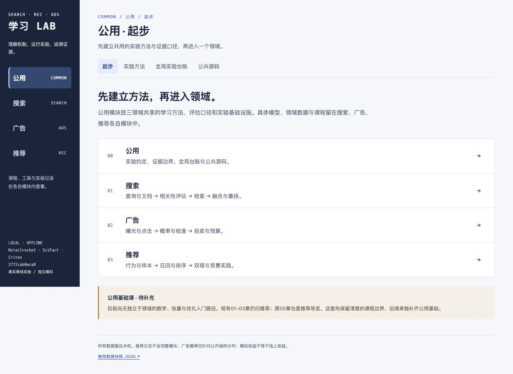

# 搜推广告学习 Lab · Search Recommendation Ads Lab

以 Notebook 为主线的同一搜推广告学习系统：真实推荐与XMRec冠军核心方法、SciFact搜索与重排、Criteo点击预测及独立模拟拍卖。共31本 Notebook，配套45份公开讲义。

## 克隆后，一条命令配置

实测环境：Apple M1 Pro、16GB、macOS15。macOS要求Apple Silicon和14以上；其他系统尚未做完整验收。建议预留至少5GB磁盘。无需Docker、Podman或GPU。

```bash
git clone https://github.com/lynnlee1229/search-recommendation-ads-lab.git
cd search-recommendation-ads-lab
# macOS缺少OpenMP运行库时先执行：brew install libomp
./setup.sh
```

需要已有uv或Python3。脚本使用uv>=0.13.6；缺少合适版本时从官方PyPI将固定版uv安装到项目.setup-tools，不替换全局工具。随后：

1. 根据uv.lock安装项目Python3.12环境和依赖。
2. 从固定原始公开地址下载68项数据/讲义，逐项核对字节数和SHA-256；另校验5份冠军参考源码。
3. 准备Retailrocket，训练热门/ItemCF与四组双塔；准备XMRec并训练缺失的竞赛实验。
4. 注册项目内核、执行pytest和教学API检查，顺序执行11~15五本竞赛Notebook。

首次需要联网下载约376MiB公开输入，以及Python和依赖；耗时受网络影响。下载支持有限重试、断点续传及冻结哈希校验。完成文件会跳过，已有成功模型会保留。脚本不会自动启动服务，不要求数据账号或浏览器凭据；若原站要求认证或哈希变化，会失败并报告，不跳过校验。

可选：`./setup.sh --download-only`只安装环境并校验输入；`./setup.sh --no-notebooks`完成训练测试但不执行Notebook。发生下载中断后重新运行同一命令。失败训练目录会保留供检查；不会自动覆盖不完整实验。

## 打开学习入口

```bash
./lab.sh up
./lab.sh notebook
```

打开 http://127.0.0.1:18580 ，先在“公用”了解实验约定，再选择搜索、广告或推荐。每个领域的“学习路径”提供该领域的 Notebook；课程、交互、实验记录与源码都留在各自模块内。推荐的01/02学习真实数据与双塔，03~10为机制实验，11~15为XMRec实践。原00仍是推荐导览，不充当三领域公用基础课。

工作台18580、Jupyter18581均仅监听127.0.0.1。Jupyter保留随机token认证，同源入口会完成本机登录。已有其他程序占用端口时请先核查，脚本不会代替你停止它们。

```bash
./lab.sh status
./lab.sh notebook-status
./lab.sh notebook-stop  # 先保存Notebook
./lab.sh stop
```

Notebook代码和项目源码可编辑，使用Search Recommendation Ads Lab (Python 3.12)内核。02的Run All会新建训练实验；其他章节分别标注真实数据、构造张量或模拟流量。学习约定见[NOTEBOOK_FIRST.md](docs/NOTEBOOK_FIRST.md)。

## 仓库包含什么

- Python源码、前端、31本带教学输出的Notebook、锁文件、测试、公开下载清单。
- [M1 Pro实测结果](results/2026-10-30-m1-pro/README.md)：聚合指标、训练曲线、配置和校验来源。
- 数据集、讲义PDF、模型权重、逐用户预测、日志、环境、缓存和认证信息均不上传。`data/`和`artifacts/`由配置脚本在本机生成。

已有本机训练产物不会因上传被删除。克隆者会自行下载数据并重训，而不是把静态结果文件当作可用模型。

## 验证与新实验

```bash
.venv/bin/python -m pytest -q
.venv/bin/python scripts/verify_restored_lab.py
.venv/bin/python scripts/execute_notebooks.py --only 11_XMRec_Start 12_XMRec_Features 13_XMRec_Graph 14_XMRec_Ranking 15_XMRec_Evaluation
.venv/bin/python -m reclab.competition run --tag my-experiment
```

图模型最多4线程，LightGBM单线程。模型按select选型，audit独立报告；不使用保留测试集调参，不声称隐藏测试成绩。当前方法是教学核心复现，非完整冠军集成、生产实时链路或线上收益证明。

## 数据与方法来源

- [Retailrocket](https://www.kaggle.com/datasets/retailrocket/ecommerce-dataset)
- [XMRec官方数据](https://github.com/hamedrab/wsdm22_cup_xmrec)
- [OPDAI冠军方案](https://github.com/opdai/wsdm2022-xmrec-top1-solution)
- [王树森推荐系统讲义](https://github.com/wangshusen/RecommenderSystem)

固定版本、下载地址、哈希分别记录在DATA_DOWNLOADS.json和docs/xmrec_sources.json。数据与讲义仍受原发布方条款约束，仓库不再分发它们。课程目录覆盖不等于完整论文复现；更多方法边界见[XMREC_REPRODUCTION.md](docs/XMREC_REPRODUCTION.md)。

## 新增：同一系统中的深入实验

```bash
.venv/bin/python -m reclab.deep_recommendation
.venv/bin/python scripts/execute_notebooks.py --only 16_Recommendation_Experiments
```

16章对比均匀/热门/难负例、mean/GRU/带位置注意力、精确/12簇粗索引；默认12000条真实因果样本、4轮、2个种子。正式旧双塔不覆盖。结果进入同一工作台“共享实验记录”，共用实验记录/API，搜索与广告共用该接口。详细协议见[推荐深化](docs/RECOMMENDATION_DEPTH.md)。


## 新增：同一系统的真实搜索

```bash
.venv/bin/python -m reclab.search --download
.venv/bin/python scripts/execute_notebooks.py --only 17_Search_Experiments
```

第17章使用公开 SciFact 的完整5,183篇文档与300测试查询，实际比较BM25、冻结MiniLM、RRF、训练线性重排、小型TinyBERT重排及共享粗索引。下载约110MiB固定版本数据/权重，逐项SHA校验；无需账号。未判断文档按不相关计分，神经模型没有微调。每次新建共享实验记录，共享实验记录可实际输入查询检索，推荐功能保留。详见[搜索协议与来源](docs/SEARCH_EXPERIMENTS.md)。搜索是显式可选命令，原setup流程保持推荐/XMRec，避免首次设置自动增加模型下载与推理预算。


## 新增：同一系统的真实广告点击与模拟决策

```bash
.venv/bin/python -m reclab.ads --download
.venv/bin/python scripts/execute_notebooks.py --only 18_Ads_Experiments
.venv/bin/python scripts/verify_ads.py
```

第18章使用官方Criteo真实曝光点击：约46MiB固定SHA分片，明确取前20万行；训练线性/特征树模型，独立select/calibration/audit，报告AUC、logloss、Brier、可靠性与分段。线性在本轮优于树，sigmoid改善不确定，isotonic负结果保留。抽样比例未知，概率不代表线上CTR。二价拍卖、出价和预算pacing使用独立模拟市场，所有收入仅为模拟。

推荐、搜索、广告共用一个仓库、下载校验器、append-only实验目录、FastAPI、共享实验记录与31本Notebook；概率指标单独抽象，领域指标不混比。工作台可实际计算匿名特征的点击概率，并独立改变模拟预算和出价。来源、协议、实测与局限见[广告实验](docs/ADS_EXPERIMENTS.md)。广告下载/训练同样是显式可选，不增加原setup默认预算；数据、权重和逐条明细保留本机。


### 广告深入课程（保留18综合章）

| 章节 | 主要问题 | 实际单变量实验 |
|---|---|---|
| 19 数据与切分 | 曝光标签、缺失、重复与训练边界 | label翻转不改变分区；复制压力测试；训练词表覆盖 |
| 20 线性特征 | 稀疏onehot、缺失指示、系数含义 | 40k真实曝光，数值特征 vs 加类别，实际两次拟合 |
| 21 非线性 | 交叉表达、容量与过拟合 | 构造XOR的交叉对照；真实树7/15叶实际训练 |
| 22 校准 | proper scores、分箱敏感性与审计 | 独立calibration重拟合同一sigmoid；5/10/20箱对照 |
| 23 拍卖出价 | 二价支付、外部竞争与价值 | 单请求手算、固定市场出价倍数与三种子 |
| 24 预算整合 | pacing、资格与预测偏差 | 同市场开关pacing、紧预算、估计概率偏差压力测试 |

每章先预测、输入/形状检查、短格运行与解释练习。20/21的教学训练也新建同一ads实验记录，仅报告select，**不替换200k正式实验**；数据、权重与逐条结果仍留本机。工作台课程目录统一提供31本入口。批量执行可用 `scripts/execute_notebooks.py --only` 指定19~24的完整文件stem。


### 搜索深入课程（保留17综合章）

25 任务与qrels → 26 倒排与BM25 → 27 语义编码 → 28 近似索引 → 29 融合与重排训练 → 30 误差分析与统一服务。六本共32个短代码格，含手算/形状断言、真实查询单变量实验、实际两组训练与五种API逐文档核验。[逐章内容、执行命令和子集边界](docs/SEARCH_COURSE.md)。广告19～24与搜索25～30共用同一实验目录、数据与服务；旧综合章不覆盖。

## 按模块学习

一级导航固定为**公用 / 搜索 / 广告 / 推荐**。算法和工具只出现在所属模块内；双塔训练位于“推荐 → 双塔训练”，不会与领域并列。

| 模块 | 内容与边界 |
|---|---|
| 公用 | 起步、实验方法、全局实验台账、公共源码；共享方法与设施，不汇集所有领域工具 |
| 搜索 | 搜索学习路径、检索实验、搜索实验记录、搜索源码 |
| 广告 | 广告学习路径、真实点击预测、独立模拟拍卖与预算、广告实验记录、广告源码 |
| 推荐 | 推荐学习路径、数据与基线、召回与重排、特征与样本、双塔训练、推荐实验记录、讲义与论文、推荐源码 |

31本现有Notebook按实际内容归属：推荐17本（含原00与01–03）、搜索7本、广告7本。每条路径内部再按入门、机制、综合或深入阶段组织，可查找本模块章节。领域实验记录自动限制在当前领域；全局台账只在公用模块。源码同样按公共/领域边界收纳。旧 `#experiments` 等链接自动转到有正确父模块的地址，刷新与浏览器前进后退均保留层级。

**已确认缺口：公用基础课程。** 目前没有独立的数学、张量、梯度与优化入门路径。推荐01–03不能只改名就算公用课程，原00也只覆盖推荐。本轮先明确边界，后续在单独session补课。详见[产品结构与归属](docs/PRODUCT_ARCHITECTURE.md)。

首次安装默认只准备推荐/XMRec；搜索与广告按各节命令显式准备。原API、Python包名reclab、内核ID、数据与Git历史保持兼容。前端结构与旧链接回归可运行 `node --test tests/navigation.test.cjs`（Node18+，不增加Python安装依赖）。



[窄屏界面截图](docs/screenshots/mobile.png)
